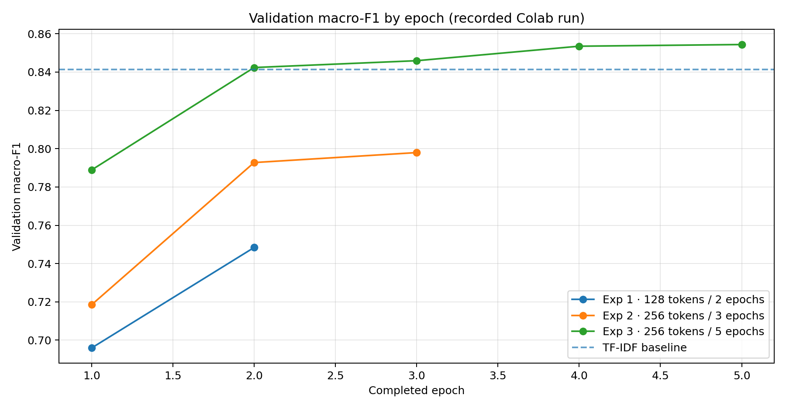

# Automotive Vehicle Safety Complaint Classification — CP5403

**JCU CP5403 Large Language Models**

This project evaluates whether supervised classification fine-tuning of pretrained GPT-2 improves the categorisation of written complaints about vehicle-safety. It compares the model which was fine-tuned with the baseline model (TF-IDF + logistic regression) on the same partitions of data.

> **Interpretation:** The dataset which are used in this project are complaints about vehicle safety. They are categorised into air bags, electrical systems, brakes, structures and other components.

## Main results - Executed Google Colab run

| Model | Validation accuracy | Validation macro-F1 | Test accuracy | Test macro-F1 |
|---|---:|---:|---:|---:|
| TF-IDF + logistic regression | 0.8426 | 0.8414 | **0.7213** | **0.5686** |
| GPT-2 Exp 1 (128 tokens, 2 epochs, last block) | 0.7558 | 0.7484 | — | — |
| GPT-2 Exp 2 (256 tokens, 3 epochs, last block) | 0.8033 | 0.7980 | — | — |
| GPT-2 Exp 3 (256 tokens, up to 5 epochs, last 3 blocks) | **0.8594** | **0.8544** | 0.6610 | 0.5397 |

* The metrics come from the experiment and they are checked against `results/metrics.json` and predictions which contains only labels for classes. 

The GPT-2 performs better for the validation where the dataset is balanced but not for the test where the dataset is imbalanced. 

## Dataset

- Dataset: [vic35get/nhtsa_complaints_dataset](https://huggingface.co/datasets/vic35get/nhtsa_complaints_dataset)
- Fixed revision: `943738a6baf3e04027da6c199605782342f819b3`
- Published: train 8356, eval 2089, test 2089; total 12534
- Cleaned: **train 8320**, **validation 2084**, **test 2074**; total 12478
- Classes: `AIR BAGS`, `ELECTRICAL SYSTEM`, `OTHER`, `SERVICE BRAKES`, `STRUCTURE`
- Feature: `summary` of complaint **only** 
- Exclusions: missing fields; descriptions which are shorter than 20 characters; duplicate IDs, summaries which are identical.

## How to Reproduce in Colab

1. Open [`notebooks/CP5403_Automotive_GPT2_Colab.ipynb`](notebooks/CP5403_Automotive_GPT2_Colab.ipynb) in [Google Colab](https://colab.research.google.com/).
2. Select **Runtime → Change runtime type → T4 GPU**, if available.
3. **Run cells from the beginning in order**; the pip cell installs versions used during the original run.
4. The notebook downloads the public dataset itself; no manual CSV upload or private account credentials are required for the public release.
5. The three training are run one after another. Each training start with the pretrained model. The dataset for validation is used to select the best model. Section 9 presents the evaluation using the dataset for the test.
6. Run the cell for evidence-export to download the results. The results may vary due to differences in GPU hardware, software packages and random behaviour during training

The experiment was run with Python 3.13.16, PyTorch 2.14.1+cu130, Transformers 4.57.3, Datasets 4.4.1 and Tesla T4. See `requirements.txt` 

## Availability of Model and Privacy

The model is not available in this repository. However, it is backed up on Google Drive. The repository does not include raw descriptions of the complaint, NHTSA narratives which are identifying, access tokens, model checkpoints or files from Google Drive. The notebook recreates the classifier by training from the public dataset.

## References and links

- Hugging Face dataset: https://huggingface.co/datasets/vic35get/nhtsa_complaints_dataset
- Hugging Face GPT-2 documentation: https://huggingface.co/docs/transformers/v4.57.3/en/model_doc/gpt2
- Original training model: https://huggingface.co/gpt2
- NHTSA public complaint data: https://www.nhtsa.gov/nhtsa-datasets-and-apis
- GitHub large file limits: https://docs.github.com/en/repositories/working-with-files/managing-large-files/about-large-files-on-github
